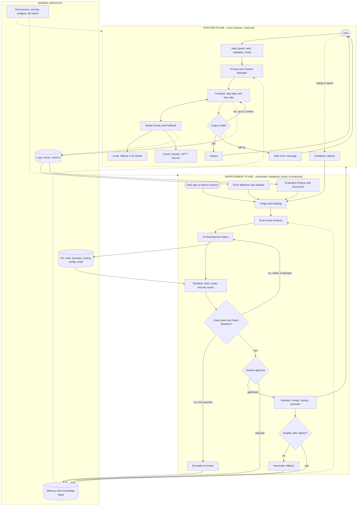

# Self-Improving AI Application System: Architecture Review and Design

Three diagrams were reviewed:

- **Sketch**: the hand-drawn diagram (Claude → App → log/scorecard → Evaluation Engine → update).
- **Build flow**: the flowchart from User Request to Improvement Proposal.
- **Fix flow**: the flowchart from Tests Pass? to Sandbox Test.

**The main recommendation:** split the system into a *runtime plane* (serves requests, never changes itself) and an *improvement plane* (proposes changes as Git branches, never touches production directly). Most of the improvement plane already exists as Git, pull requests and CI. You only need to build four things yourself: the app template, the eval suite, the triage job and the routing config.

---

## 1. Analysis of the original diagrams

### What the design gets right

| Decision | Why it is right |
|---|---|
| Human approval sits on the Make and Update arrows | The human gates changes, not every request. This is the correct place. |
| A stronger model evaluates than the one that builds ("use best model" on the Evaluation Engine) | A judge should be independent of, and at least as capable as, the generator. |
| Logs feed a scorecard, which feeds evaluation | Improvement is driven by evidence, not by the agent's opinion of its own work. |
| Sandbox before release gates (Build flow) | Generated code never runs on the host first. |
| Retry limit with human escalation (Fix flow) | The only loop in the three diagrams that has a termination condition. |
| Rejections are recorded (Build flow) | Remembering what was refused is as valuable as remembering what worked. |

### What needs changing

| # | Problem | Where | Why it matters | Change |
|---|---|---|---|---|
| 1 | Improvement Proposal goes straight to Human Approval, then to commit and deploy | Build flow | An untested proposal can be approved and shipped. You would be approving a description, not a tested change. | Every proposal re-enters the same sandbox → test → gate path as new code. |
| 2 | Git commit happens after approval | Build flow | What was tested and what gets committed are not provably the same thing. | Commit to a branch first. Test that commit. Approval merges that exact commit. |
| 3 | Error Diagnosis → Development Agent loop has no limit | Build flow | Infinite loop that burns tokens if the agent cannot fix the failure. | Max 3 attempts per task, then escalate. |
| 4 | Rejected → Store → Improvement Engine → Proposal → Human Approval | Build flow | The engine can re-propose what you just rejected, forever. | Store a fingerprint of rejected proposals. Do not re-propose without new evidence. |
| 5 | Test feeds Compute inside the running app | Sketch | Tests are a development-time activity. At runtime you need output *validation*, which is a different thing. | Tests move to the improvement plane. Runtime gets a validator with a bounded retry. |
| 6 | The Evaluation Engine both judges the app and updates it | Sketch | The judge and the builder are the same component, so it can grade its own work. | The Evaluation Engine only scores. The Development Agent only builds. |
| 7 | User feedback flows through a model into the app's Input | Sketch | Free text from users becomes instructions to the system: a prompt-injection path. | Feedback is stored as data in the backlog. It is evidence for triage, never a command. |
| 8 | Model Router is one pipeline step that picks local or cloud once | Build flow | Routing is a per-call decision, and there is no fallback when a model is down. | The router is a service every model call goes through, with fallback chains. |
| 9 | Memory retrieval is one pipeline step | Build flow | The runtime, the RCA step and the dev agent all need memory at different times. | Memory is a shared service. |
| 10 | Every detected error starts a fix pipeline | Fix flow | One bug hit 500 times creates 500 fix attempts. Transient errors (timeouts, rate limits) need no code fix at all. | Fingerprint and deduplicate errors. Triage by severity and frequency first. |
| 11 | "Tests pass" is treated as "the error is fixed" | Fix flow | The existing tests passed before the bug too. | A fix must add a test that reproduces the error and fails without the fix. |
| 12 | Human Approval has no reject branch; deploy has no rollback | Fix flow, Build flow | A bad release has no recovery path. | Canary release, health check, automatic rollback. |
| 13 | Security, lightweight, user-friendly, memory are a note under the app | Sketch | A note cannot fail a build. | Turn each into a measurable gate (scan results, latency budget, memory budget). |
| 14 | Runtime and development are drawn as one flow | All three | It is unclear what happens per request versus per change, and what is allowed to modify what. | Two planes with one-way contracts between them. |

### Overlaps to remove

- **Planner Agent + Workflow Orchestrator + Development Agent.** A modern coding agent plans and executes. Start with one agent. Add an orchestrator only when you have multi-step workflows that must survive restarts.
- **Error Diagnosis (Build flow) and Root Cause Analysis (Fix flow).** These are the same component.
- **Improvement Engine and Evaluation Engine.** Keep them separate, but with a sharp line: Evaluation produces scores; Improvement turns scores, errors and feedback into ranked proposals.

---

## 2. Missing components

| Missing | Why it is needed | Mandatory? |
|---|---|---|
| Output validator at runtime | Catches malformed or unsafe output before the user sees it | Yes |
| Error fingerprinting and deduplication | Prevents duplicate fix pipelines | Yes |
| Triage and backlog | One queue for errors, eval regressions and user feedback, ranked | Yes |
| Baseline comparison | A change must beat the current version on the eval set, not just pass | Yes |
| Protected evaluation assets | The agent must not be able to edit the tests, gates or its own permissions to make itself pass | Yes |
| Budget and kill switch | Hard cap on tokens, cost and attempts per day; one switch stops the improvement plane | Yes |
| Secrets management | API keys must never be readable inside the sandbox or by generated code | Yes |
| Post-deploy verification and rollback | Confirms the change helped in production; reverts if not | Yes |
| Risk tiers for approval | Without tiers you become the bottleneck and start rubber-stamping | Yes |
| Fallback manager | Model outage or rate limit should degrade, not fail | Yes |
| Canary or shadow release | Limits the blast radius of a bad change | Optional at first |
| Semantic cache | Cost and latency saving | Optional |

---

## 3. Improved architecture

Two rules hold the design together:

1. **The runtime plane never modifies itself.** It reads code, prompts and routing config from a tagged Git release.
2. **The improvement plane never touches production.** Its only output is a Git branch. The only way to production is the release step, after approval.

---

## 4. Components

"Reuse" means an existing tool does the job. "Build" means you write it.

| # | Component | Responsibility | Must not do | Mandatory? | Build or reuse |
|---|---|---|---|---|---|
| 1 | AI Development Agent | Turns a spec or backlog item into a branch with code, tests and a change summary | Merge, deploy, or edit protected files | Yes | Reuse |
| 2 | Application Runtime Engine | Input guard → compute → validate → output, with a trace ID on every step | Change its own code, prompts or config | Yes | Build (template) |
| 3 | Model Router and Fallback Manager | Maps a task type to a model through a versioned routing table; retries and falls back on failure | Choose models by guesswork; routing changes only through Git | Yes | Reuse |
| 4 | Prompt and Context Manager | Loads versioned prompts, assembles context, enforces a token budget | Hold prompts as strings inside code | Yes | Build (small) |
| 5 | Memory and Knowledge Base | Stores decisions, errors with their fixes, rejected proposals, eval history | Store secrets or raw user data without a retention rule | Yes, start simple | Reuse |
| 6 | Evaluation and Benchmarking Engine | Runs the golden set against any version; produces the scorecard; compares against baseline | Propose or apply changes | Yes | Reuse + build the dataset |
| 7 | Automated Testing and Validation | Unit and integration tests in the sandbox; output validator at runtime | Be editable by the agent in the same change as the code it tests | Yes | Reuse |
| 8 | Security and Permission Management | Secrets, per-tool allow-lists, sandbox network policy, dependency and secret scanning | Expose credentials to generated code | Yes | Reuse |
| 9 | Logging, Monitoring and Observability | Structured logs, traces of every model and tool call, cost and latency metrics | Log secrets or full personal data | Yes | Reuse |
| 10 | Error Detection and RCA | Fingerprints errors, counts them, classifies transient or persistent, finds the cause for persistent ones | Start a fix for a transient or already-tracked error | Yes | Build (small) + agent |
| 11 | User Feedback System | Thumbs up or down plus free text, linked to the trace ID | Feed text to a model as instructions | Yes | Build (small) |
| 12 | Human Approval and Control Layer | Risk-tiered review of a diff with eval evidence attached | Approve anything that has not passed gates | Yes | Reuse (pull requests) |
| 13 | Version Control and Rollback | One repo holds code, prompts, routing config and evals; every release is a tag | Allow untracked changes to production | Yes | Reuse |
| 14 | Continuous Improvement Engine | Scheduled job: ranks the backlog, opens at most N proposals per cycle, records outcomes | Run on every event; run without a budget | Yes, phase 5 | Build |
| 15 | Deployment and Release Management | Builds an image from a tag, releases to canary, promotes or rolls back | Deploy an unapproved commit | Yes | Reuse |
| 16 | Triage and backlog | Single ranked queue for errors, regressions and feedback | — | Yes | Reuse (issue tracker) |
| 17 | Budget and kill switch | Daily caps on cost, attempts and open proposals | — | Yes | Reuse (router budgets) + a flag |
| 18 | Workflow orchestrator | Durable multi-step workflows with pause and resume | — | Optional | Reuse, later |

### The scorecard

One row per release. A change must not regress any gate metric, and must improve its target metric by more than run-to-run noise.

| Metric | Source | Role |
|---|---|---|
| Task success rate on the golden set | Evaluation Engine | Gate |
| Test pass rate | Sandbox | Gate (must be 100%) |
| Security findings (high or critical) | Scanners | Gate (must be 0) |
| p95 latency | Traces | Gate (budget) |
| Peak memory | Sandbox | Gate (budget) |
| Cost per request | Router | Tracked, gate if over budget |
| Error rate in production | Logs | Triggers rollback |
| User rating | Feedback | Tracked |

### Approval tiers

| Tier | Examples | Approval |
|---|---|---|
| 0: automatic | Runtime retry, model fallback, rollback to the previous release | None. Logged. |
| 1: batch review | Prompt edits, routing table changes, model parameters | You approve a batch with eval results attached |
| 2: explicit review | Code changes, new dependencies, new tools, deployments | You review each diff |
| 3: explicit, never bundled | Changes to tests, eval sets, gates, permissions, CI config | Separate change, reviewed alone |

Tier 3 is what stops the system improving its score by weakening the test.

---

## 5. End-to-end data flow

### A. Runtime (per request, seconds)

1. **Entry.** Request hits the input guard: authentication, schema validation, size and rate limits. A trace ID is created.
2. **Context.** The Prompt and Context Manager loads the prompt version pinned in this release, retrieves relevant memory, trims to the token budget.
3. **Model selection.** Compute declares a task type (for example `classify`, `extract`, `reason`). The router looks it up in the routing table and returns the primary model and its fallback chain. On timeout, rate limit or server error it tries the next model.
4. **Compute and tools.** App logic runs. Tool calls are checked against the allow-list for this app. Each call is traced.
5. **Validation.** Output is checked against a schema and safety rules. On failure, retry up to 2 times with the validation error included, then return a safe error. This loop is bounded.
6. **Output and logging.** Response returned. Logs, traces, cost and latency are written against the trace ID.
7. **Feedback.** A rating or report from the user is stored with the trace ID.

Nothing in steps 1 to 7 changes code, prompts or routing.

### B. Improvement (scheduled, hours to days)

1. **Collect.** Error detection groups log errors by fingerprint and counts them. The Evaluation Engine runs the golden set nightly and on every candidate. Feedback arrives in the same backlog.
2. **Triage.** Items are ranked by frequency × severity. Transient errors are closed with a note. Duplicates attach to the existing item.
3. **Diagnose.** RCA takes the top items, pulls the traces, checks memory for similar past errors and failed fixes, and names the affected component and channel (code, prompt or routing).
4. **Propose.** The Development Agent creates a branch with the change and a test or eval case that reproduces the problem.
5. **Test.** The sandbox runs tests, the eval suite and security scans against that commit, with no network and no secrets.
6. **Gate.** Pass only if all gates hold and the candidate beats the baseline. Fail returns to the agent with the failure output, for at most 3 attempts, then escalates.
7. **Approve.** You see the diff, the reproducing test, and the before and after scorecard. Rejection is stored with your reason.
8. **Release.** Merge, tag, build, deploy to canary.
9. **Verify.** If the error rate or scorecard regresses in the observation window, roll back automatically.
10. **Remember.** Memory records the item, the change, the outcome (shipped, rejected, rolled back, abandoned) and why.

---

## 6. Self-improvement design

### Three independent channels

| | Code | Prompts and workflows | Model selection and configuration |
|---|---|---|---|
| What changes | Source files | Prompt files, workflow definitions | Routing table, temperature, max tokens, fallback order |
| Typical trigger | Persistent error, failed test, feature request | Low eval score on a task type, bad ratings | Cost or latency over budget, a new model available |
| How it is evaluated | Tests + golden set + scans | Golden set, old prompt versus new prompt on the same model | Golden set, old model versus new model on the same prompt |
| Approval tier | 2 | 1 | 1 |
| Deployment | New image | Config release, no rebuild | Config release, no rebuild |
| Rollback | Previous image | Previous prompt version | Previous routing table |

**Change one channel per proposal.** If a prompt and a model change together and the score moves, you cannot tell which caused it.

### What "improving the model" means here

| Term | What it is | Can this system do it? |
|---|---|---|
| Model selection | Choosing which existing model handles a task type | Yes, automatically proposed, human approved |
| Model configuration | Parameters, system prompt, context size, quantisation of a local model | Yes, same path |
| Fine-tuning | Adapting an open-weight model on your data (for example LoRA) | Not automatically. A separate offline project you start by hand. The result enters the router as a new candidate and must win on the eval set like any other model. |
| Model training | Creating or retraining base weights | No. Out of scope. Cloud model weights cannot be modified at all. |

The system never changes weights. It changes which model is called and how.

### Loop safeguards

| Loop | Risk | Termination condition |
|---|---|---|
| Runtime validate → retry | Endless regeneration | Max 2 retries, then safe error |
| Model fallback | Cycling through providers | Each model tried once per request, then fail |
| Gate fail → agent → gate | Token burn | Max 3 attempts per item, then escalate |
| Error → fix → new error → fix | Fix cascades | One open proposal per component; a rolled-back fix puts the item on hold |
| Reject → re-propose | Nagging the human | Rejected fingerprint is blocked until new evidence exists |
| Noise-chasing | Endless small changes that do nothing | Must beat baseline by more than the measured noise |
| Improvement engine overall | Runaway cost | Scheduled runs only, N proposals per cycle, daily cost cap, kill switch |
| Monitor → collect → monitor | None; this is a normal polling loop | Fixed interval |

---

## 7. Recommended technology stack

Check the current licence and release status of each before adopting; this list is from general knowledge, not a fresh survey.

| Component | Recommendation | Why | Status |
|---|---|---|---|
| Development agent | Claude Code or the Claude Agent SDK. Open alternatives: OpenHands, Aider | Already plans, edits, runs tests and works on branches. Do not rebuild this. | Essential |
| Local models | Ollama (LM Studio as a desktop alternative) | OpenAI-compatible local endpoint, simple model management | Essential for local |
| Router and fallback | LiteLLM proxy | One API for Ollama, Claude, GPT and Gemini; fallbacks, budgets and cost tracking in config. Pin the version: it holds every API key you have. | Essential |
| Prompts | Plain files in Git | Versioning, diff and rollback for free | Essential |
| Memory | SQLite to start; PostgreSQL + pgvector when you need concurrency or semantic search | One database for structured records and vectors. Avoid a separate vector database until you have a reason. | Essential (SQLite), optional (vectors) |
| Tests | pytest (or your language's standard runner) | Standard, agent-friendly | Essential |
| Evaluation | promptfoo or Inspect AI | Declarative eval sets, model and prompt comparison, CI-friendly | Essential |
| Sandbox | Docker with no network and a read-only mount | Good enough isolation for your own generated code | Essential |
| Stronger sandbox | gVisor or Firecracker | For running untrusted or third-party code | Optional |
| Security scans | gitleaks (secrets), Semgrep (code), Trivy (dependencies and images) | Cheap gates that catch the common failures | Essential |
| Tracing | OpenTelemetry + Langfuse (self-hosted) | Per-call traces with cost, latency and prompt version | Essential from phase 2 |
| Metrics and dashboards | Prometheus + Grafana | Standard, but only worth it once you run several apps | Optional |
| Error grouping | GlitchTip or self-hosted Sentry | Fingerprinting and deduplication already solved | Optional; a hash of error type + top stack frame works at first |
| Version control and approval | Git + pull requests on GitHub, or Forgejo self-hosted | Diff review, protected branches, code owners and audit trail. This *is* the approval layer. | Essential |
| CI | GitHub Actions or Forgejo Actions | Runs the gates on every branch | Essential |
| Backlog | The issue tracker of the same Git host | No new system to build | Essential |
| Deployment | Docker Compose with tagged images | Rollback is redeploying the previous tag | Essential |
| Progressive delivery | Kubernetes + Argo Rollouts | Real canary analysis | Optional, much later |
| Orchestration | LangGraph | Durable graphs with human-in-the-loop interrupts | Optional; add only when a script and CI are no longer enough |

---

## 8. Implementation roadmap

Each phase is usable on its own. Do not start a phase until the previous one's exit test passes.

| Phase | Build | Exit test |
|---|---|---|
| 0: Foundation | Git repo. App template with input guard, compute, validator, structured logs and trace IDs. Docker sandbox. pytest. Protected main branch. | The agent builds a small app on a branch; tests run in the sandbox; you merge by pull request. |
| 1: Models | LiteLLM in front of Ollama and one cloud model. Routing table and prompts as files. Fallback chain. Daily budget. | Stop Ollama mid-request; the request still succeeds via fallback. |
| 2: Measurement | Golden eval set (start with 20 to 30 cases). Scorecard. Tracing. Feedback capture. Gates in CI including security scans. | A deliberately worse prompt is blocked by CI. |
| 3: Diagnosis | Error fingerprinting. Triage job that opens issues. RCA and fix proposals as pull requests with a reproducing test. Retry limit. Outcome memory. | Inject a bug; one issue and one pull request appear, not one per occurrence. |
| 4: Safe release | Canary deploy, post-deploy health check, automatic rollback. Approval tiers. Code owners on tests, evals and CI. | A release that raises the error rate rolls itself back. |
| 5: Improvement | Scheduled improvement engine across all three channels. Rejection fingerprints. Baseline-plus-noise threshold. Kill switch. | A week of unattended running stays inside the budget and produces no repeated proposals. |

The golden eval set in phase 2 is the most valuable thing in the whole system and the one part no tool will write for you. Every later phase depends on it.

---

## 9. Future upgrades

- Shadow testing: run a candidate on live traffic without showing its output, compare against production.
- Fine-tuning a small local model on approved traces, to move routine tasks off cloud models.
- Routing learned from eval history instead of a hand-edited table.
- Semantic caching for repeated requests.
- A second, independent reviewer model on every proposal before it reaches you.
- Multiple apps sharing the improvement plane, with a per-app scorecard.
- MicroVM sandboxes and a policy engine (Open Policy Agent) if you start running code you did not generate.
- Growing the golden set automatically from production failures, with you approving each new case.
