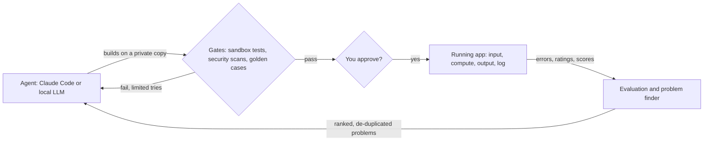

# Forge

Forge is an architecture you can run: an AI agent builds an app, Forge tests it in a sandbox, a human approves it, and Forge keeps watching the running app and proposing fixes.

Connect Claude Code (or any MCP client, including ones driven by a local model) and ask for an app. The agent writes it; Forge decides whether it is good enough; you decide whether it ships.



Design and reasoning: [ARCHITECTURE.md](ARCHITECTURE.md).

## What you need

| Tool | Needed for |
|---|---|
| Python 3.11+ and Git | Everything. No Python packages to install. |
| Docker Desktop | The sandbox. Without it nothing an agent writes will be run, so nothing can pass the gates. |
| Ollama or another OpenAI-compatible model server | Only for apps that use a model, and for Forge's own built-in fixer. Plain apps need no model at all. |

## Quick start

```bash
git clone https://github.com/AmshuKM/forge.git
```

```bash
cd forge
```

```bash
python -m forge.cli serve
```

Open http://127.0.0.1:8765. That is the dashboard: use apps, review changes, see health.

## Choose your models

On first start Forge looks for model servers on your computer (Ollama, LM Studio, llama.cpp, vLLM and Unsloth, on their usual ports) and picks a model for each of four roles:

| Role | Used for | Picked by |
|---|---|---|
| `main` | Everyday answers | Long context window first, then the largest that fits your GPU |
| `think` | Writing fixes, judging answers | The same, among models that can reason |
| `fast` | Quick small jobs | The smallest |
| `big` | Backup when `main` fails | The largest that fits |

To see what was found and choose yourself:

```bash
python -m forge.cli setup
```

It lists every model and asks for each role; press Enter to keep a suggestion. Your choice is saved in `config/local.toml`, which stays on your computer and is never committed. A server that needs a key (Unsloth Studio does) is reported with the environment variable to set. To add a pay-per-use cloud model, see the end of [config/routing.toml](config/routing.toml).

## Build an app with Claude Code

Open the folder in Claude Code. It reads [.mcp.json](.mcp.json) and offers to connect the `forge` tools; accept. Then ask in plain words:

> Build an app called `slugify` that turns a title into a URL slug.

The agent gets seven tools and nothing else: `guide`, `status`, `start_change`, `read_file`, `write_file`, `check_change`, `submit_change`. It works in a private copy, can only touch its own app's files, and has no tool to approve or release. When it finishes, the change appears under **Review changes** with its test output and diff. Approve it and the app shows up in the dashboard.

Any other MCP client works the same way: point it at `python -m forge.mcp`, run from this folder.

## Testing without a model

- Unit tests always run with no network and no model.
- Apps that don't call a model are tested end to end with no model installed. [apps/slugify](apps/slugify) is one.
- To try an app that does use a model without having one, set `FORGE_MOCK=1` before starting Forge. Model calls return a fixed stand-in reply, so the plumbing runs but the answers are not meaningful.

## What an app is

```
apps/<name>/app.py              the app: form fields, input checks, the work, output checks
apps/<name>/tests/test_*.py     unit tests
apps/<name>/evals/golden.jsonl  the cases every future change is scored against
prompts/<name>_*.md             optional, only for apps that call a model
```

[apps/slugify](apps/slugify) is a plain app; [apps/docqa](apps/docqa) uses a local model.

## How a change reaches a running app

1. A change is made on its own Git branch, by a connected agent or by Forge's built-in fixer after it finds a repeated error, a failing golden case or a "not good" rating.
2. It must pass unit tests, three security scanners and the golden cases, and must not score lower than the current version. Tries are limited; after that it stops and asks you.
3. You approve or reject. Rejections are remembered.
4. An approved change to an existing app handles half the requests for a short trial. If they fail it is discarded; otherwise it is merged and tagged `release-<n>`. A brand-new app is released directly.

Shared limits and which role handles which work live in [config/routing.toml](config/routing.toml). Your own models live in `config/local.toml`.

## Commands

```bash
python -m forge.cli eval slugify
```

```bash
python -m forge.cli improve
```

```bash
python -m unittest discover -s tests
```

## Safety, plainly

- Agent-written code only ever runs inside a Docker container with a read-only copy of the project, a memory cap and no API keys. Unit tests get no network.
- The dashboard listens on your own computer only.
- Nothing is released without your click, and the Health page has a switch that stops all self-improvement.
- This is a personal tool, not a hardened multi-user service. Do not expose the dashboard to a network.

MIT licence. See [LICENSE](LICENSE).
