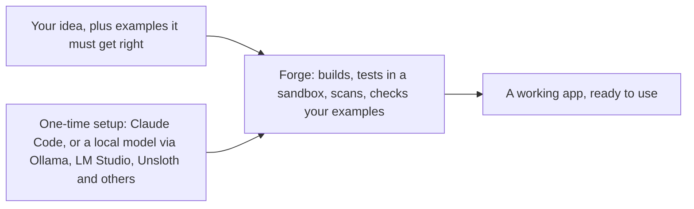

# Forge

Type an app idea. Get a working app.



Inside the Forge box: the builder writes the app in a private copy; Forge runs its tests in a locked Docker sandbox, scans it for security problems and checks it against your examples, then sends it back to the builder with the failures, a limited number of times. When everything passes, the app goes live. Forge then keeps watching the running app and proposes fixes, which wait for your approval.

Design and reasoning: [ARCHITECTURE.md](ARCHITECTURE.md).

## What you need

| Tool | Needed for |
|---|---|
| Python 3.11+ and Git | Everything. No Python packages to install. |
| Docker Desktop | The sandbox. Without it nothing an agent writes will be run, so nothing can pass the gates. |
| Ollama or another OpenAI-compatible model server | Only for apps that use a model, and for Forge's own built-in fixer. Plain apps need no model at all. |

## Quick start

```bash
git clone https://github.com/AmshuKM/forge.git
```

```bash
cd forge
```

```bash
python -m forge.cli serve
```

Open http://127.0.0.1:8765. That is the dashboard: use apps, review changes, see health.

## Choose your models

On first start Forge looks for model servers on your computer (Ollama, LM Studio, llama.cpp, vLLM and Unsloth, on their usual ports) and picks a model for each of four roles:

| Role | Used for | Picked by |
|---|---|---|
| `main` | Everyday answers | Long context window first, then the largest that fits your GPU |
| `think` | Writing fixes, judging answers | The same, among models that can reason |
| `fast` | Quick small jobs | The smallest |
| `big` | Backup when `main` fails | The largest that fits |

To see what was found and choose yourself:

```bash
python -m forge.cli setup
```

It lists every model and asks for each role, then which builder to use; press Enter to keep a suggestion. Your choice is saved in `config/local.toml`, which stays on your computer and is never committed. A server that needs a key (Unsloth Studio does) is reported with the environment variable to set. To add a pay-per-use cloud model, see the end of [config/routing.toml](config/routing.toml).

## Build an app

On the **Build an app** page:

1. Describe the app in plain words, for example "A scientific calculator with sin, cos, log and powers".
2. Optionally add examples it must get exactly right, one per line: `2+3*4 -> 14`. These become checks the builder cannot change, so you set the standard rather than the AI.
3. Press **Build it** and watch the progress page. It usually takes a few minutes.

When every check passes, the app appears under **My apps**. If it can't pass after three tries, the page says why, and the work is kept.

The builder is chosen at setup: Claude Code when it is installed and signed in (best results; it uses your Claude plan or API credit), otherwise your local model (free, but small models fail more builds). If Claude Code fails mid-build, Forge switches to the local model.

## The dashboard's design

The dashboard is designed as a railway departure board: each check is a row whose status word flips as it changes. The rules live in [DESIGN.md](DESIGN.md) (colours, type, components) and [PRODUCT.md](PRODUCT.md) (who it is for). When you open this folder in Claude Code, it offers the [Impeccable](https://github.com/pbakaus/impeccable) design plugin, set up in [.claude/settings.json](.claude/settings.json). Accept it if you want to change the dashboard's look under the same rules; Forge works without it.

## Build from your own agent instead

Forge also speaks MCP. Open this folder in Claude Code and accept the `forge` tools it offers, or point any MCP client at `python -m forge.mcp`. The agent gets seven tools: `guide`, `status`, `start_change`, `read_file`, `write_file`, `check_change`, `submit_change`. It works in a private copy, can touch only its own app's files, and has no tool to approve or release; its changes wait on **Review changes**.

## Testing without a model

- Unit tests always run with no network and no model.
- Apps that don't call a model are tested end to end with no model installed. [apps/slugify](apps/slugify) is one.
- To try an app that does use a model without having one, set `FORGE_MOCK=1` before starting Forge. Model calls return a fixed stand-in reply, so the plumbing runs but the answers are not meaningful.

## What an app is

```
apps/<name>/app.py              the app: form fields, input checks, the work, output checks
apps/<name>/tests/test_*.py     unit tests
apps/<name>/evals/golden.jsonl  the cases every future change is scored against
prompts/<name>_*.md             optional, only for apps that call a model
```

[apps/slugify](apps/slugify) is a plain app; [apps/docqa](apps/docqa) uses a local model.

## How a change reaches a running app

1. A change is made on its own Git branch, by a connected agent or by Forge's built-in fixer after it finds a repeated error, a failing golden case or a "not good" rating.
2. It must pass unit tests, three security scanners and the golden cases, and must not score lower than the current version. Tries are limited; after that it stops and asks you.
3. A new app you asked for goes live as soon as it passes. Anything else (a change to an existing app, a fix Forge proposed, work from an outside agent) waits for you to approve or reject it. Rejections are remembered.
4. An approved change to an existing app handles half the requests for a short trial. If they fail it is discarded; otherwise it is merged and tagged `release-<n>`.

Shared limits and which role handles which work live in [config/routing.toml](config/routing.toml). Your own models live in `config/local.toml`.

## Commands

```bash
python -m forge.cli eval slugify
```

```bash
python -m forge.cli improve
```

```bash
python -m unittest discover -s tests
```

## Safety, plainly

- Agent-written code only ever runs inside a Docker container with a read-only copy of the project, a memory cap and no API keys. Unit tests get no network.
- The dashboard listens on your own computer only.
- Only apps you asked for yourself go live without a click, and only after passing every check. Everything else waits for you. The Health page has a switch that stops all self-improvement.
- This is a personal tool, not a hardened multi-user service. Do not expose the dashboard to a network.

MIT licence. See [LICENSE](LICENSE).
